<h1></h1>

A collection of Claude Code skills.

## Install (Claude Code)

```
/plugin marketplace add xdgfx/skills
/plugin install xdgfx-skills@xdgfx
```

## Install (npx skills)

```bash
npx skills add xdgfx/skills@tracker-sweep
```

## Skills

### Moved: wireviz and pipeviz

Both were replaced by one `ferrule` skill, which lives with the renderer in
[XDGFX/ferrule](https://github.com/XDGFX/ferrule) (`skills/ferrule`): `npx skills add xdgfx/ferrule@ferrule`.

### fusion-modelling

Rules for building Autodesk Fusion models the way a disciplined person would, so the result can be
opened, read and changed by hand: the origin on a functional datum, native sketch tools, a few
dimensions between the things they relate, named parameters only for shared or measured values,
holes and repeats as features, assemblies held by the joints the real thing has, and fasteners
from Fusion's library instead of modelled. Carries the Fusion API call behind each tool, and a blind
review in which a second agent reads the finished model without knowing what the part is.

### fusion-gate (plugin)

Lets several agents share one Fusion. A hook on every `mcp__fusion360__*` call asks a small lock
service for a turn. The service lets one call at a time through. It lends Fusion to one session at
a time, or to several that declared different documents. Before each call from a sharing session it
makes one of that session's documents active and reads it back, and refuses the call if it can't, so
no agent's call runs in another's document. If the gate can't check a call, it refuses the call
rather than let it through. It keeps a queue that puts short reads first, notices when Fusion has
crashed, and pauses agents while you use Fusion, resuming once you stop. The hook starts the
service when it's first needed, and your MCP config is left alone.

```
/plugin install fusion-gate@xdgfx
```

Needs `uv`. Then `python3 <plugin>/fusion_gate.py status|pause|resume`, or ask any agent to pause
Fusion for you.

While agents share Fusion, the gate refuses any script that names another agent's document, and
any script that isn't read-only and uses `app.documents` (apart from `documents.add`). Before and after
each of their write calls it reads every held document's saved state, timeline, parameter and
occurrence counts. If another agent's document changed during the call, the gate notifies you,
tells the document's owner to check it before saving, and refuses the calling agent's write calls
until it releases. A document an agent creates or opens is its own for the lease, and nobody
else's afterwards.

What it can't catch:

- The scan reads the script and files it runs through `exec(open('/path.py').read())`. It doesn't
  read imported modules, so a helper like `hailey_part.py` that opens or saves documents isn't
  seen. Code assembled at run time, such as `getattr(app, 'docu' + 'ments')`, isn't seen either.
- The tripwire detects a change; it doesn't prevent one. A call that changes and saves another
  agent's document is caught only afterwards, and the saved version stays in the document's
  history. It doesn't block the owner, and it forgets everything when the gate restarts.
- A document only counts as changed if it was read before the call, so one that an agent was
  granted mid-call, or that wasn't open, isn't compared.
- Once an agent releases, its documents, including any it created, are nobody's. Unsaved work
  then has only `protect` to keep other agents off it.
- A change that leaves the save flag, timeline, parameter count and occurrence count all as they
  were goes unnoticed, for example a parameter's value edited in a document that was already
  unsaved.
- Two open documents with one name, such as two unsaved "Untitled", can't be told apart. Calls that
  would need to choose between them are refused.
- With no `-d`, an agent holds all of Fusion and the only checks are on protected documents: it
  can't save or close one, but it can still change one in memory.
- The hook must answer within Claude Code's 90 s hook limit, or Claude Code runs the call anyway.
  The gate gives up at 85 s, so a very slow Python start-up could still let a call through.
- A call during which you touch Fusion isn't blamed on the agent. Changes to other agents'
  documents are still flagged.
- Calls that skip the hook, such as from a session that started before the plugin was updated,
  aren't gated at all.

### tracker-sweep

Audit a GitHub issue tracker for staleness, wrong or missing blockers, duplicates, conflicting
tickets, orphaned epic children and ordering mistakes — then propose fixes and apply only the
approved ones. Every write is re-validated against the live tracker first, and the whole plan is
refused if any single action has gone stale. Designed to be re-run every few days on a large
tracker: the second sweep only deep-reads what moved. Trigger: `/tracker-sweep`.

### ticket-workflow

Carry a GitHub Issues ticket from claim to merge when several agents share one GitHub account: the
assignee is the lock and a claim comment breaks ties, one worktree branch per ticket, draft PRs,
merge and clean-up, and closing on delivery, including into integration branches. Sits on top of
the `docs/agents/issue-tracker.md` that mattpocock/skills' `setup-matt-pocock-skills` writes.

## Forks

`forks/` holds third-party skills carried with local changes, each with its upstream licence and
an `UPSTREAM` file naming the commit it is based on. `forks/upstream-sync.sh check [fork]` lists
upstream commits not yet taken in; `merge <fork>` three-way merges them. Forks are not part of
the plugin.

- `improve-codebase-architecture` from [mattpocock/skills](https://github.com/mattpocock/skills)
  (MIT): the report is built from a filled template with dark mode and before/after cards.
- `setup-matt-pocock-skills` from [mattpocock/skills](https://github.com/mattpocock/skills) (MIT):
  seeds a `## Gates` section and a `parked` label, and points the tracker doc at `ticket-workflow`.
